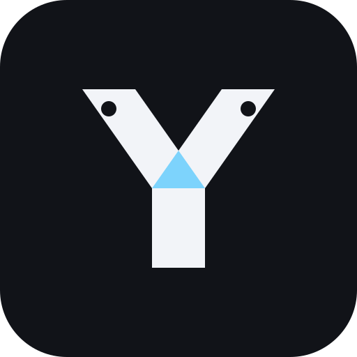

# Yunari

Makes **Yunari** appear as one hub in SignalRGB's Devices and Layouts pages, with
one independently placeable subdevice per lighting device Yunari owns. The plugin
only speaks HTTP and UDP to Yunari; it never opens HID, USB or serial itself.

## Requirements

- Yunari running on the same machine, HTTP API on `127.0.0.1:5227` and UDP
  lighting frames on the port advertised in its descriptor (default `7788`).
- SignalRGB `2.5.86` (tested).
- SignalRGB's own NZXT Kraken plugin **disabled** for the Kraken device.

## Installation

1. Click the button above, or open SignalRGB → **Settings → Add-ons → Add Add-on**
   and paste `https://github.com/peterng1618/signalrgb-yunari`.
2. Restart SignalRGB when prompted.
3. Open **Devices**, find the NZXT Kraken Z entry from SignalRGB's built-in
   plugin and disable it — both apps cannot open the same device. Leave Yunari
   enabled.
4. Open **Layouts**; the Yunari hub and each of its lighting devices are listed
   separately.

## Settings

| Setting | Meaning | Default |
| --- | --- | --- |
| Yunari API host | Host serving `GET /api/devices`; leave blank for `127.0.0.1`. | `127.0.0.1` |
| Yunari API port | HTTP port Yunari listens on. | `5227` |
| Fallback devices | Descriptor used while Yunari is unreachable. | `kraken-z:40:rings:3:3:3` |
| Layout model | `Subdevices` (placeable, real geometry) or `Channels`. | `Subdevices` |
| Lighting Mode | `Canvas` follows the effect, `Forced` uses one colour. | `Canvas` |
| Forced Color | Colour used in `Forced` mode. | `#009bde` |
| Shutdown Color | Written when SignalRGB shuts down. | `#000000` |

## Troubleshooting

- **Yunari is listed but nothing changes.** Yunari is not running, or is on a
  different host/port. Set Yunari API host and port, then reload the device.
- **The Kraken's glass scrambles or the LCD flickers.** SignalRGB's own Kraken
  plugin is still enabled and writing to the same device. Disable it.
- **Devices are missing from Layouts.** Switch Layout model to `Channels` — some
  SignalRGB builds do not enumerate subdevices.
- **Lighting devices show wrong shapes.** The descriptor is authoritative; the
  fallback only applies while `/api/devices` is unreachable.

## Support

Open an issue on this repository.

## License

MIT — see `LICENSE`.
